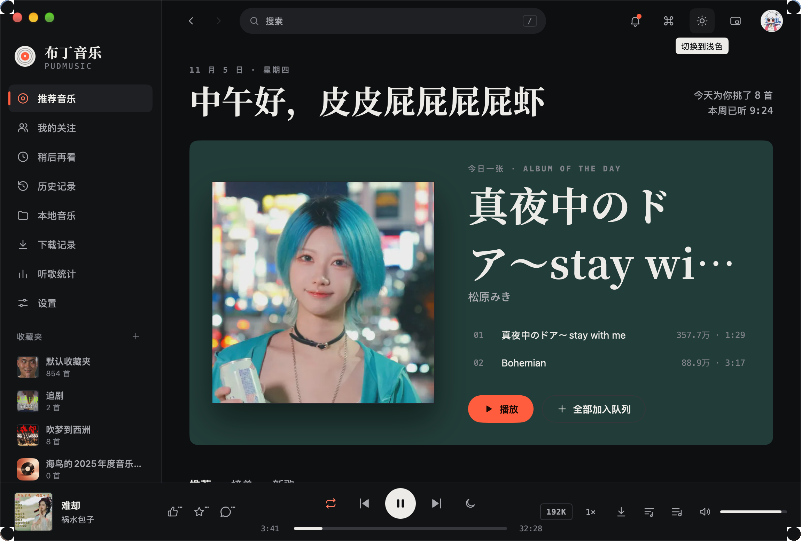

# PudMusic · 布丁音乐

一款面向 macOS 和 Windows 的桌面音乐播放器。

PudMusic 使用 Go 和 [MyGo](https://github.com/egoist/mygo) 原生 UI 构建，在 [Biu](https://github.com/wood3n/biu) 的基础上重新实现并扩展。界面不依赖 WebView，音频播放链路使用 Go 解码器和操作系统音频能力，播放、下载与解码均为应用内实现，不依赖系统 ffmpeg 或其他外部解码组件。

> 项目仍在持续开发中。功能、平台支持和安装包状态会随版本变化。

[下载 Releases](https://github.com/ShellMonster/PudMusic/releases) · [报告问题](https://github.com/ShellMonster/PudMusic/issues)

## 界面预览

### 首页与播放条（浅色 / 深色）

<p align="center">
  
</p>

<p align="center">
  
</p>

### 迷你播放器

<p align="center">
  
</p>

截图来自当前版本的实际应用界面。展示内容仅用于说明界面，不代表推荐或授权任何具体音乐内容。

## 功能

### 播放与音频

- 播放 B 站音乐内容，支持登录后获取可用的在线音质档位。
- 支持 Hi-Res 无损和 AAC 等在线音质；切换音质后会重新取流并从原播放位置继续。
- 支持本地 FLAC、MP3、WAV、AIFF/AIFC、AAC、M4A 和 OGG Vorbis。
- 支持播放速度调整、音量均衡和睡眠定时。
- 重启后恢复播放队列、当前歌曲和播放位置，恢复后保持暂停。
- 缓存网络封面，减少重复下载。

### 音乐库与内容发现

- 推荐音乐首页、榜单和新歌速递。
- 搜索音乐内容。
- 浏览 UP 主空间、用户动态和我的关注。
- 管理收藏夹、合集和系列。
- 使用稍后再看和历史记录。
- 下载内容并查看下载记录。
- 下载支持音频和视频两种格式，可分别选择。
- 将本地音频文件拖入窗口导入音乐。
- 听歌统计：最近 7 天收听时长、最常听的歌手和本周单曲循环。
- 歌曲评论：右侧抽屉查看，不离开当前播放页。
- 点赞同步到指定收藏夹，收藏多选放进多个歌单。

### 队列与播放器

- 播放条和播放队列抽屉。
- 播放模式：顺序、循环、随机、单曲四档。
- 拖动调整队列顺序。
- B 站合集 / 系列在队列里作为一摞连播，可展开收起；支持整体或单个限成「仅播第一首」。
- 支持立即播放、下一首播放和添加到队列。
- 全屏播放器和迷你播放器。
- 边放边看 MV：封面右下「看视频」进入影院模式，支持画质切换和弹幕。
- 十段均衡器：满屏播放器底栏可调，支持预设和自定义保存。
- 分集抽屉：多 P 视频在播放条一键切集。
- macOS 刘海播放器：收起是刘海两翼的封面与频谱，展开是完整播放卡。
- 歌词显示。
- 列表加载时显示与内容同形的骨架屏，不再是空白等待。

### 桌面集成

- 系统托盘或菜单栏入口。
- 单实例运行和开机自启。
- 系统媒体控制。
- 双击音频文件，或将文件拖到程序坞图标上打开。
- 支持 `biu://` 链接和常见音频文件关联。
- 自动更新。
- 常规、菜单、快捷键和代理设置。

## 支持平台

| 平台 | 架构 | 状态 |
|---|---|---|
| macOS | arm64 / amd64 | 支持 |
| Windows | amd64 / arm64 | 支持 |
| Linux | amd64 / arm64 | 最小可发行 |

macOS 当前提供 DMG 安装包，首次打开未公证的应用时可能需要在系统提示中确认打开。Windows 当前提供 amd64 和 arm64 安装包，安装包未进行代码签名，系统可能显示 SmartScreen 提示。Linux 提供 Debian/Ubuntu 的 `.deb` 包与通用 `.tar.gz` 自装包（含 `install.sh`，装入 `~/.local`），Arch 用户可用随包 `PKGBUILD` 自行 `makepkg -si`。

## 当前边界

- 当前只支持 B 站扫码登录。
- `internal/ui/router.go` 登记的 14 条路由里已经有 13 条有自己的画法
  （`builtPage`）并接上真数据；剩下 `/empty`（空状态落地页）按设计该空，
  走的是这一页自己的空状态。
- 本地暂不支持 WMA。
- AIFF/AIFC 目前只支持未压缩 PCM，压缩编码无法播放。
- MP4、M4A 或 MP4 相关容器中的 ALAC 音轨暂不支持。
- B 站音乐 MV 支持边放边看和影院模式，但播放器仍以音频为主。
- 杜比音轨不能手动选择；不同平台的系统解码能力也不同。
- Windows 的 AAC/有损在线音频路径依赖 Media Foundation，部分场景的实际播放表现可能与 macOS 不同。
- Linux 首发是**最小可发行**：登录态（扫码登录）、AAC/M4A 解码、视频播放和 MPRIS 媒体控制还没接（各留后续票）。托盘图标走 AppIndicator——桌面不带 `libayatana-appindicator3` 的发行版上它建不出来（应用照跑，记一行日志），这一档没有系统级回归覆盖（见 `.github/workflows/linux.yml` 的 E2E 注释）。
- macOS 和 Windows 的系统媒体控件能力不同，例如 Windows 媒体浮窗当前不显示封面。
- 当前不提供 Mac App Store 版本。

## 技术栈

| 领域 | 技术 |
|---|---|
| 主要语言 | Go |
| 桌面 UI | [MyGo](https://github.com/egoist/mygo) 原生即时模式 UI |
| 应用打包 | MyGo CLI、macOS DMG、Windows NSIS 安装包、Linux tar.gz/deb/PKGBUILD |
| 音频链路 | Go 解码器、macOS AudioToolbox、Windows Media Foundation |
| 平台集成 | 文件关联、URL Scheme、单实例、托盘/菜单栏、开机自启、系统媒体会话 |
| 在线内容 | B 站公开内容与扫码登录后的可用接口 |

主要开源依赖包括：

- `github.com/egoist/mygo`：原生 UI、应用生命周期和打包。
- `github.com/ebitengine/purego`：调用部分 macOS 系统 API。
- `github.com/mewkiz/flac`：FLAC 处理。
- `github.com/tphakala/go-m4a`：M4A/MP4 容器处理。
- `github.com/Eyevinn/mp4ff`：MP4/DASH 相关处理。
- Ogg Vorbis 相关库：OGG Vorbis 音频处理。
- 仓库内 vendor 的 `tphakala/go-mp3`：MP3 解码。

完整依赖和许可证信息见 [`NOTICE`](NOTICE)、[`LICENSE`](LICENSE) 和 [`resources/licenses/THIRD-PARTY-NOTICES.txt`](resources/licenses/THIRD-PARTY-NOTICES.txt)。

## 安装与运行

### 下载发行版

从 [Releases](https://github.com/ShellMonster/PudMusic/releases) 下载对应平台的安装包：

- macOS：DMG
- Windows：amd64 或 arm64 安装包
- Linux：Debian/Ubuntu 用 `.deb`；其余发行版用 `.tar.gz`（`sh install.sh` 装入 `~/.local`）；Arch 用 `PKGBUILD`（`makepkg -si`）。

### 从源码运行

需要 Go 1.27 或更新版本：

```sh
go run .
```

### 构建与测试

```sh
go build ./...
go vet ./...
go test ./...
```

构建安装包：

```sh
scripts/build.sh
```

构建 Windows 安装包需要安装 NSIS。应用使用 MyGo CLI 进行跨平台打包。Linux 目标在 Linux 上直接打，在任何宿主上交叉打也可以（MyGo 不用 cgo）：

```sh
scripts/build.sh linux/amd64 linux/arm64
```

## 项目来源与致谢

PudMusic 是对 [Biu](https://github.com/wood3n/biu) 的 Go 原生 UI 重构与扩展。项目保留了 Biu 作为音乐播放器的产品方向，并根据 MyGo 的原生桌面能力重新实现界面、播放链路和平台集成。

感谢以下项目和社区提供的基础能力与参考：

- [MyGo](https://github.com/egoist/mygo)：Go 原生桌面 UI 框架与应用打包工具。
- [Biu](https://github.com/wood3n/biu)：项目参考和重构来源。
- [mewkiz/flac](https://github.com/mewkiz/flac)：FLAC 处理。
- [tphakala/go-m4a](https://github.com/tphakala/go-m4a)：M4A/MP4 容器处理。
- [Eyevinn/mp4ff](https://github.com/Eyevinn/mp4ff)：MP4 相关处理。
- [ebitengine/purego](https://github.com/ebitengine/purego)：Go 与系统 API 的互操作支持。

使用、修改和分发本项目及其依赖时，请遵守各自的许可证要求。

## 许可证

本项目使用 PolyForm Noncommercial 1.0.0 发布。项目基于 Biu 的公开项目进行重构，Biu 的版权和许可证要求见 [`LICENSE`](LICENSE)。商业化使用需要另行取得原作者授权。

第三方依赖的许可证原文随项目和安装包提供，详见 [`NOTICE`](NOTICE) 与 [`resources/licenses/THIRD-PARTY-NOTICES.txt`](resources/licenses/THIRD-PARTY-NOTICES.txt)。
